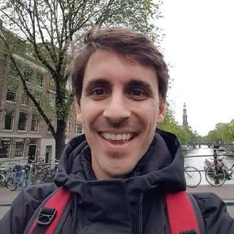

  

Staff Software Engineer with 10+ years of experience building scalable, resilient, and high-performance systems in both high-growth and global-scale environments.

At <strong>Adyen</strong>, I’m scaling our core payment ledger — the engine that processes and serves all payment data, handling up to <strong>199k</strong> transactions per minute in 2025.

Previously, I was Klue’s <strong>1st hire</strong> in Amsterdam, where I helped establish their Machine Learning office alongside an early employee. 

Earlier, I joined Defined.ai as one of their first engineers, supporting its growth from <strong>7 to 150 employees</strong> over 3 years.

