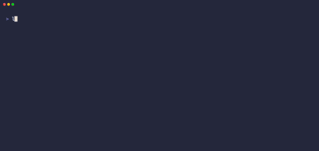
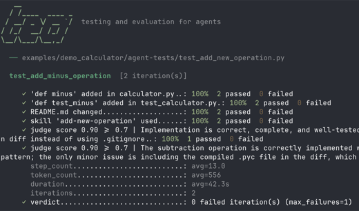
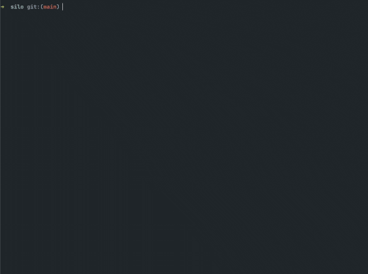

  

    
    

      

        <h2 class="cv-project-title">Lintmatter</h2>
        2026
      

      
Linter for agent context files such as AGENTS.md and SKILL.md. Validates formatting, references, and token budgets.

      

        Rust
      

      

        <a href="https://github.com/rsn491/lintmatter" style="font-size: 0.85em; color: #828282; text-decoration: none; display: inline-flex; align-items: center; gap: 4px;">GitHub →</a>
        <a href="https://lintmatter.onrender.com/demo" style="font-size: 0.85em; color: #828282; text-decoration: none; display: inline-flex; align-items: center; gap: 4px;">Demo →</a>
      

    

  

  

    
    

      

        <h2 class="cv-project-title">Tea</h2>
        2026
      

      
Testing and evaluation tool for agentic workflows. Run agents against tasks, assert their behavior, and measure performance.

      

        Python
        Docker
      

      <a href="https://github.com/rsn491/tea" style="font-size: 0.85em; color: #828282; text-decoration: none; display: inline-flex; align-items: center; gap: 4px;">GitHub →</a>
    

  

  

    
    

      

        <h2 class="cv-project-title">Silo</h2>
        2026
      

      
Isolated workspace manager for parallel agentic development. Run multiple AI agents on the same repo, each in their own Git worktree.

      

        Rust
        Ratatui
      

      <a href="https://github.com/rsn491/silo" style="font-size: 0.85em; color: #828282; text-decoration: none; display: inline-flex; align-items: center; gap: 4px;">GitHub →</a>
    

  

  

    

      
    

    

      

        <h2 class="cv-project-title">Chillout</h2>
        2020
      

      
P2P video chat app for hanging out with friends. Includes trivia games and YouTube sharing with no central server dependency.

      

        Vue.js
        Node.js
        PeerJS
      

      

        <a href="https://github.com/rsn491/chillout" style="font-size: 0.85em; color: #828282; text-decoration: none; display: inline-flex; align-items: center; gap: 4px;">GitHub →</a>
        <a href="https://chillout.onrender.com/" style="font-size: 0.85em; color: #828282; text-decoration: none; display: inline-flex; align-items: center; gap: 4px;">Demo →</a>
      

    

  

  

    

      
    

    

      

        <h2 class="cv-project-title">Koopera</h2>
        2019
      

      
Collaboration platform for data science teams to share and review Jupyter notebooks. Supports diffs and cell-level comments.

      

        Python

        Flask
        Vue.js
      

      <a href="https://github.com/rsn491/koopera" style="font-size: 0.85em; color: #828282; text-decoration: none; display: inline-flex; align-items: center; gap: 4px;">GitHub →</a>
    

  

